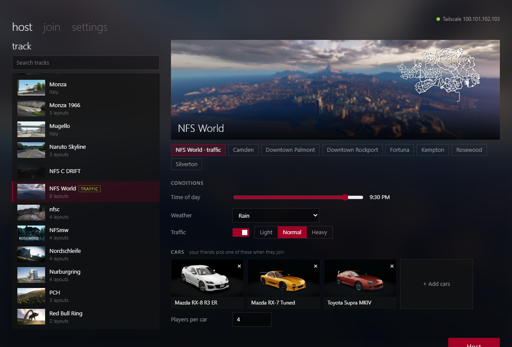
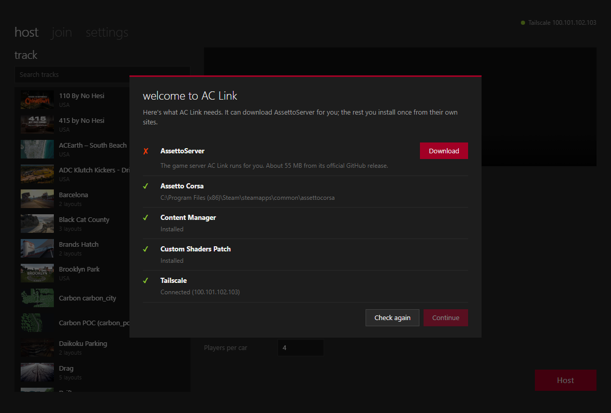
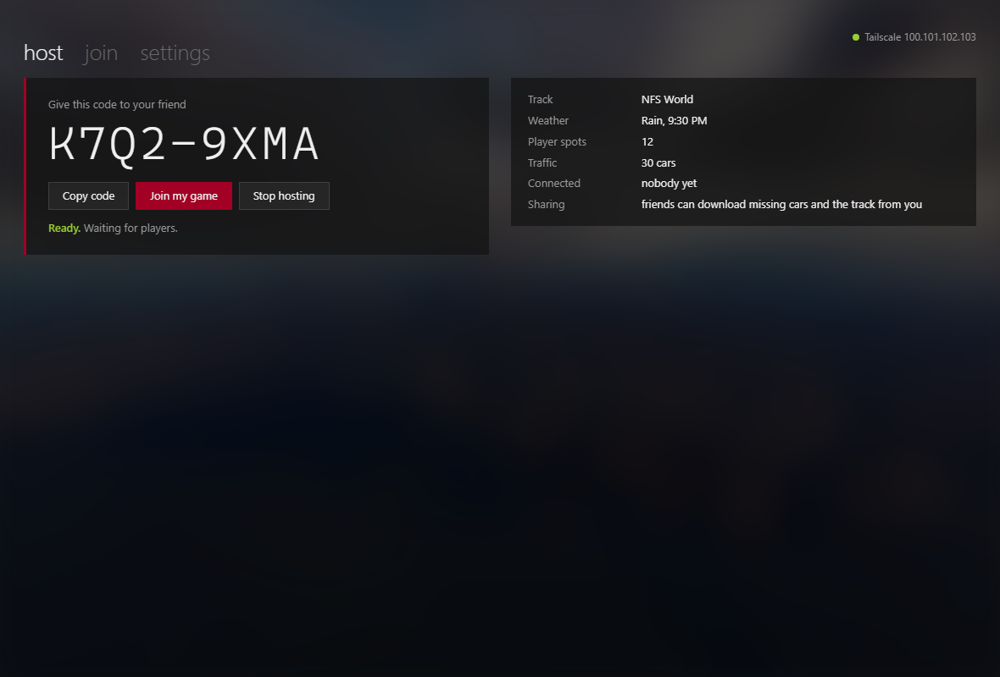
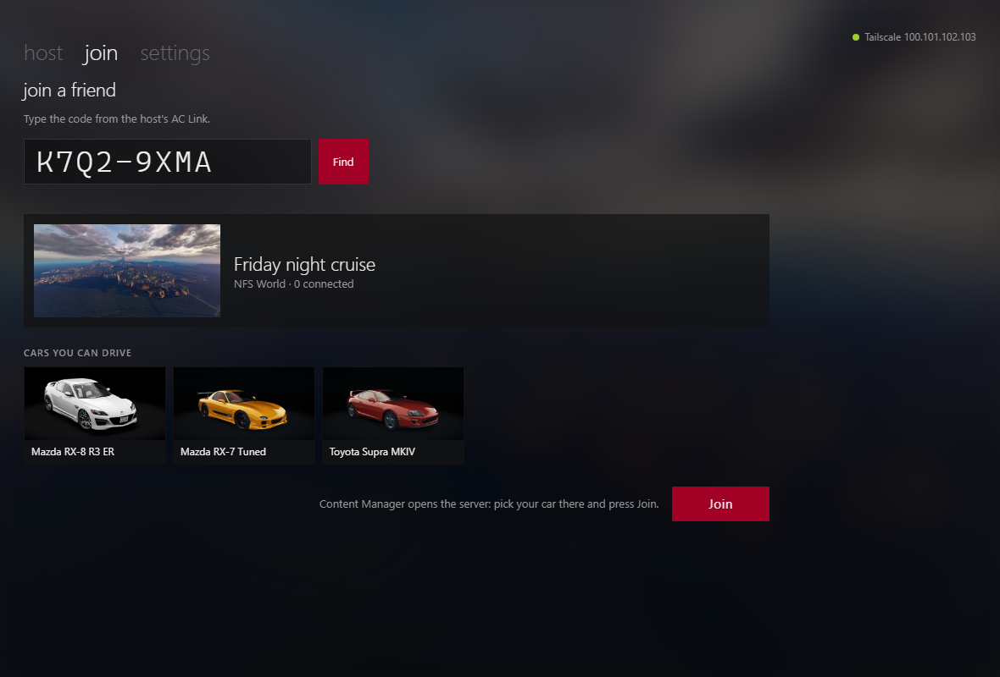
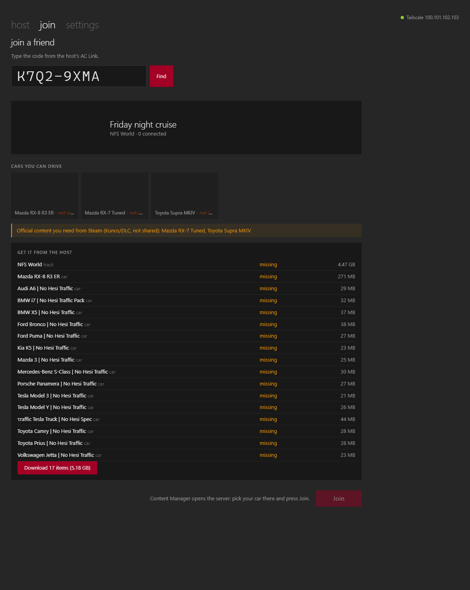
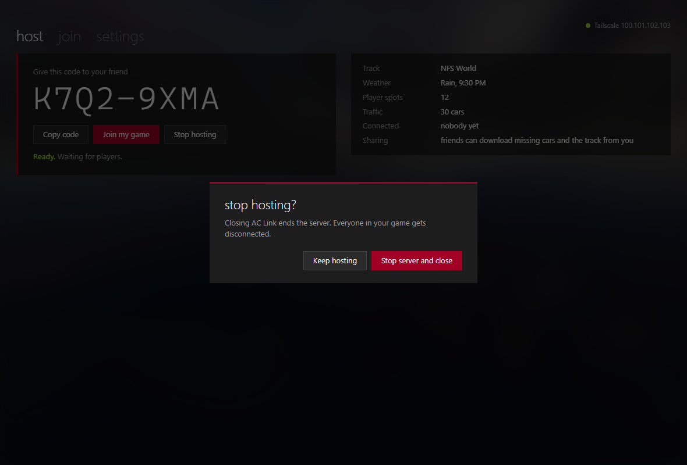
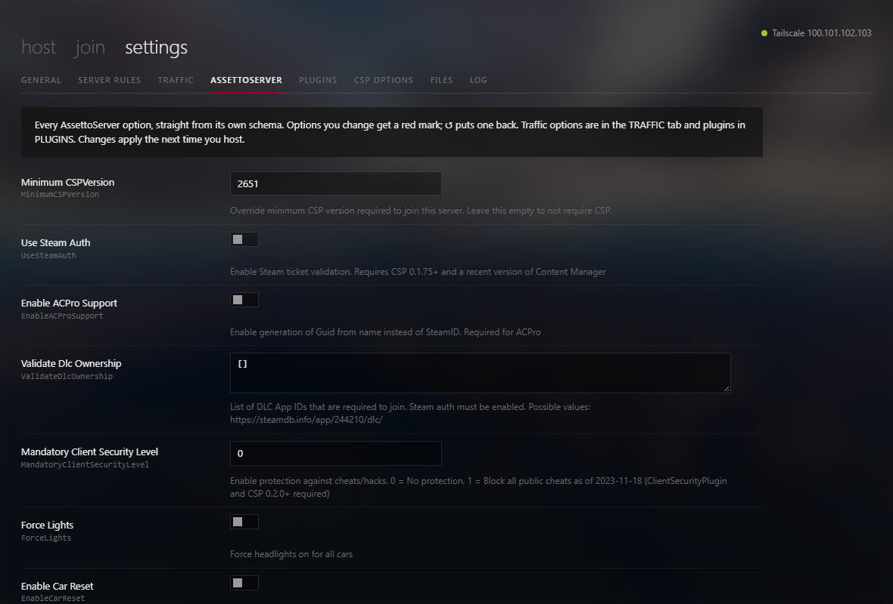
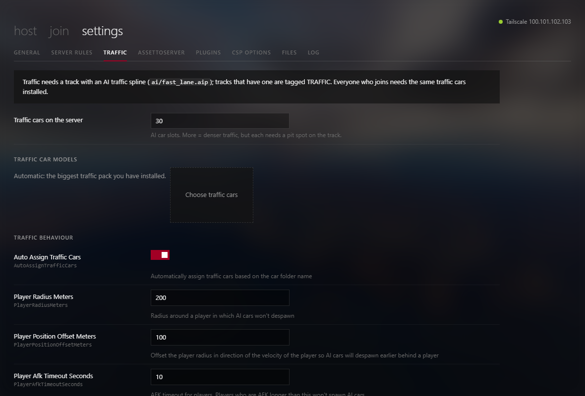
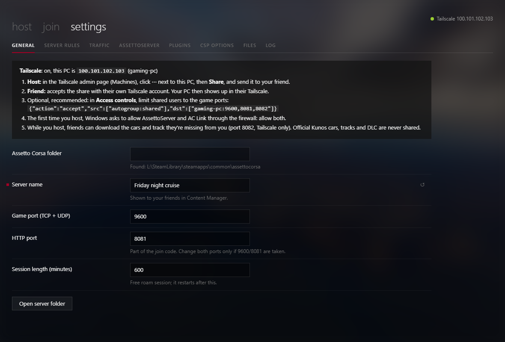

# AC Link

**Play Assetto Corsa with a friend in a couple of clicks.** One player hosts, the other types an 8-character code and joins. Traffic, rain, night driving and any track or car you both have, and if your friend is missing something, they download it straight from you.

AC Link runs an [AssettoServer](https://github.com/compujuckel/AssettoServer) for you behind a simple screen styled after Content Manager, and connects you privately over [Tailscale](https://tailscale.com). No port forwarding, no public server, no server configs.



---

## What you need

Every player needs all four of these. They're all free apart from Assetto Corsa itself.

| | What | Where to get it |
|---|---|---|
| 1 | **Assetto Corsa** (PC, Steam) | [store.steampowered.com/app/244210](https://store.steampowered.com/app/244210/Assetto_Corsa/) |
| 2 | **Content Manager**, the AC launcher (the free Lite version is fine) | [acstuff.club/app](https://acstuff.club/app/) · [direct download](https://github.com/gro-ove/actools/releases/latest/download/Content.Manager.zip) |
| 3 | **Custom Shaders Patch (CSP)**, installed from inside Content Manager | [acstuff.club/patch](https://acstuff.club/patch/) |
| 4 | **Tailscale**, a free private network between your PCs | [tailscale.com/download](https://tailscale.com/download) |

Plus **AC Link** itself: [download the latest release](../../releases/latest). On first launch AC Link downloads the one other thing it needs, [AssettoServer](https://github.com/compujuckel/AssettoServer), after asking you.

Windows 10 or 11. AC Link uses Microsoft Edge WebView2, which Windows 11 already has. On Windows 10, get it from [Microsoft](https://developer.microsoft.com/microsoft-edge/webview2/) if AC Link opens in an Edge window instead of its own.

> **Why CSP?** AssettoServer's traffic, rain and live weather all run through CSP, and the server only lets in players who have it. Content Manager installs and updates it for you (step 3 below).

---

## Setup, step by step

Each player does steps 1 to 5 once. The host also does step 6.

### 1. Install Assetto Corsa
Buy and install it on Steam, then start it once from Steam so it creates its settings, and close it.

### 2. Install Content Manager
1. Download Content Manager from [acstuff.club/app](https://acstuff.club/app/) and unzip it somewhere permanent, for example `Documents\Content Manager`.
2. Run `Content Manager.exe`. The first time, it asks where Assetto Corsa is installed. Usually that's `C:\Program Files (x86)\Steam\steamapps\common\assettocorsa`, or `steamapps\common\assettocorsa` in whichever Steam library you used.
3. Leave it on the free Lite version, which is all AC Link needs.

### 3. Install Custom Shaders Patch
1. In Content Manager open **Settings**, then **Custom Shaders Patch**.
2. Click **Install** and pick the latest recommended version.
3. Start a quick practice session once to check that AC loads with CSP.

### 4. Install Tailscale
1. Download Tailscale from [tailscale.com/download](https://tailscale.com/download) and install it.
2. Sign in. Each player uses **their own** account: Google, Microsoft, GitHub or Apple.
3. The Tailscale icon in the system tray should show **Connected**.

### 5. Install AC Link
1. Download `AC Link.zip` from [Releases](../../releases/latest).
2. Unzip it somewhere permanent, for example `Documents\AC Link`. AC Link keeps its settings and the server next to the exe.
3. Run **AC Link.exe**. The first time, it checks everything on this list and shows what's missing, with download links.
4. Click **Download** next to **AssettoServer**. AC Link fetches it (about 55 MB) from [its official GitHub release](https://github.com/compujuckel/AssettoServer/releases) and sets it up.
5. When everything has a green ✓, click **Continue**. You can run the check again any time under **Settings → General → Check setup**.



### 6. Host only: share your PC with your friends
Tailscale accounts are private, so the host lets each friend in once. ([Tailscale guide](https://tailscale.com/kb/1084/sharing))

1. Open the [Tailscale admin console → Machines](https://login.tailscale.com/admin/machines).
2. Click **⋯** next to your gaming PC, then **Share…**.
3. Send the invite by email or copy the invite link, and give it to your friend.
4. Your friend opens the link and clicks **Accept**. Your PC now shows up in their Tailscale.

Sharing lets your friend reach **only that one PC**, not the rest of your network. To lock it down to just the game, add this to [Access controls](https://login.tailscale.com/admin/acls) (AC Link shows it with your PC's name filled in under **Settings → General**):

```json
{"action": "accept", "src": ["autogroup:shared"], "dst": ["your-pc-name:9600,8081,8082"]}
```

**Firewall:** the first time you host, Windows asks whether **AssettoServer** and **AC Link** may use the network. Click **Allow** for both. If a prompt was closed by accident, AC Link shows a red warning with a **Fix firewall** button.

---

## Playing

### Host
1. Open AC Link and pick a track on **host**. Tracks tagged **TRAFFIC** have AI traffic lanes.
2. Choose the **time of day**, the **weather** (clear through thunderstorms and snow), and **traffic** (Light / Normal / Heavy).
3. Click **+ Add cars** and pick the cars your friends can drive.
4. Click **Host**. You get a code like `K7Q2-9XMA`. Send it to your friend.
5. Click **Join my game** to drive too. Content Manager opens, and AC Link minimizes itself.



### Guest
1. Open AC Link, go to **join**, type the code and click **Find**.
2. You see the host's server, track and cars.
3. If anything is missing, or you have a different version, click **Download**. AC Link copies it straight from the host's PC, and if the download stops it picks up where it left off.
4. Click **Join**. Content Manager opens the server: pick your car and press **Join**.



<details>
<summary>Downloading missing content from the host</summary>



- Official Kunos cars, tracks and DLC are never shared. They come with your own copy of AC, or from Steam.
- Free mods (No Hesi traffic packs, community tracks and so on) download with one click.
- Large tracks take a while the first time. NFS World is 4.5 GB, and the speed depends on the host's upload.
</details>

### Stopping
Click **Stop hosting**, or just close AC Link. If you're hosting, it asks first, because closing ends the server for everyone.



---

## Advanced settings

Everything AssettoServer can do is under **settings**. Most people never need it.

| Tab | What's in it |
|---|---|
| **General** | AC folder, server name, ports, session length, Tailscale help |
| **Server rules** | Password, ABS/TC/stability, damage, fuel, tyre wear, time speed, network rate |
| **Traffic** | Which traffic cars and how many, plus every AI behaviour option (speeds, spacing, two-way traffic, hourly density…) |
| **AssettoServer** | **Every** option, built from AssettoServer's own schema, so it stays complete when it updates. Changed options are marked; ↺ resets one. |
| **Plugins** | Turn on bundled plugins (random/live weather, voting, time dilation, fast travel, tag mode…) and edit their options |
| **CSP options** | Raw `csp_extra_options.ini` (for example rain without rain physics) |
| **Files** | The exact config files AC Link writes, read-only |
| **Log** | Live server log |



<details>
<summary>More screenshots</summary>



</details>

---

## Troubleshooting

| Problem | Fix |
|---|---|
| **"Can't reach the host"** | Both players need Tailscale **Connected**. The host must have shared their PC (step 6), and the guest must have accepted. The host must still be hosting. |
| **Friend gets stuck or kicked while connecting** | Make sure you have the same versions of the track and cars. Use **Download** on the join screen, which also fixes "different version". |
| **Red firewall warning** | Click **Fix firewall** and say Yes to Windows. That allows AssettoServer and AC Link on private networks only (Tailscale counts as private). |
| **No traffic** | The track needs an AI traffic spline (`ai/fast_lane.aip`). Only tracks tagged **TRAFFIC** have one. |
| **No rain** | Update CSP in Content Manager (Settings → Custom Shaders Patch). |
| **Ports 9600/8081 are taken** | Change them under Settings → General. The code changes with them. |
| **Server won't start** | Settings → Log shows why. |

---

## How it works

- **The code** packs the host's Tailscale address and the server's HTTP port into 8 characters ([Crockford base32](https://www.crockford.com/base32.html)). It only works for people the host has shared their PC with.
- **Hosting** writes an AssettoServer preset (`server_cfg.ini`, `entry_list.ini`, `extra_cfg.yml`, plugin configs), copies only the files the server checks (car `data.acd`, track `surfaces.ini`, the traffic spline) and starts AssettoServer in the background.
- **Content sharing** is a small read-only file server on the host's Tailscale address (game HTTP port + 1, so 8082). It only answers Tailscale addresses, only while hosting, and only for the hosted cars and track. The guest compares the files AC checks and downloads what differs, resuming if interrupted.
- **Joining** goes through Content Manager's `acmanager://` link.

## Building from source

Needs Python 3.10+ on Windows.

```powershell
pip install -r requirements.txt
python aclink.py                                                       # run from source; downloads AssettoServer on first launch
powershell -ExecutionPolicy Bypass -File tools\get_assettoserver.ps1   # or fetch AssettoServer from the command line
powershell -ExecutionPolicy Bypass -File tools\build.ps1               # builds AC Link.exe and share\AC Link.zip
```

## Credits

- [AssettoServer](https://github.com/compujuckel/AssettoServer) by compujuckel and contributors (AGPL-3.0). AC Link downloads it from its official release on first launch, and it runs as its own program.
- [Content Manager](https://acstuff.club/app/) and [Custom Shaders Patch](https://acstuff.club/patch/) by x4fab.
- [Tailscale](https://tailscale.com).
- [pywebview](https://pywebview.flowrl.com/) for the app window.

AC Link isn't affiliated with Kunos Simulazioni, AssettoServer, Content Manager or Tailscale.
